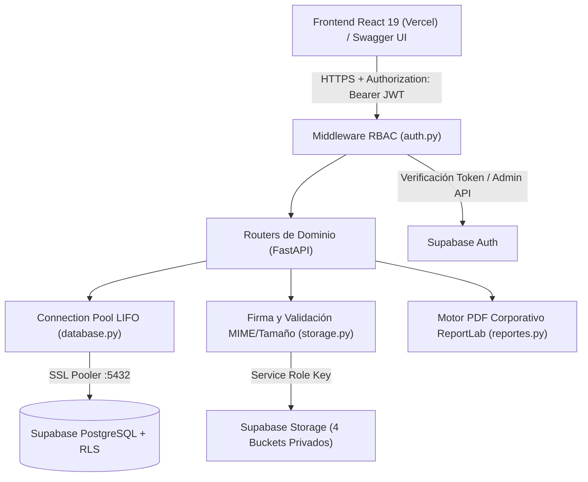

<div align="center">

# ⚙️ Backend API — Academia Preuniversitaria Virtual
### Servicio RESTful Transaccional, Control de Aulas en Vivo y Motor Documental PDF

[](https://www.python.org/)
[](https://backend-proyectofinal.fly.dev/docs)
[](https://supabase.com/)
[](https://www.docker.com/)
[](https://backend-proyectofinal.fly.dev/)
[](#pruebas-automatizadas-pytest)

<p align="center">
  Núcleo transaccional en producción de la <strong>Academia Preuniversitaria Virtual</strong>. Gestiona autenticación JWT con <strong>Supabase Auth</strong>, persistencia ACID en <strong>PostgreSQL</strong> mediante pool de conexiones reutilizables, almacenamiento privado firmado en <strong>Supabase Storage</strong> y emisión nativa de actas corporativas en PDF con <strong>ReportLab</strong>.
</p>

[Swagger UI en Vivo (`/docs`)](https://backend-proyectofinal.fly.dev/docs) · [Estado SQL (`/health/db`)](https://backend-proyectofinal.fly.dev/health/db) · [Repositorio Frontend](https://github.com/lincoln-vega/Front-ProyectoFinal)

</div>

---

## 🔐 Credenciales Oficiales de Evaluación (Sincronizadas en Producción)

Todas las cuentas siguientes están operativas en **Supabase Auth** y `public.users` para pruebas tanto desde el portal web en Vercel como desde `https://backend-proyectofinal.fly.dev/docs`:

| Rol RBAC | Correo Electrónico | Contraseña | Usuario Registrado | Especialidad / Carrera y Periodo |
| :--- | :--- | :--- | :--- | :--- |
| **Administrador** | `admin@gmail.com` | `admin123` | Roberto Carlos Morales Salazar | Dirección Académica General |
| **Docente (Titular)** | `chavez@gmail.com` | `Chavez123` | Pedro Martlon Chavez Quispe | Álgebra y Trigonometría (*Semestral UNMSM* y *Verano*) |
| **Docente** | `c.herrera@academia.edu.pe` | `Herrera123` | Carmen Rosa Herrera Villanueva | Biología, Anatomía y Química DECO (*Semestral UNMSM*) |
| **Docente** | `m.paredes@academia.edu.pe` | `Paredes123` | Miguel Ángel Paredes Ruiz | Física General y Razonamiento Matemático (*Anual UNI*) |
| **Docente** | `v.raggi@academia.edu.pe` | `Victoria123` | Victoria Angelis Raggi Ruiz | Historia del Perú, Universal y Razonamiento Verbal |
| **Estudiante 1** | `esteban@gmail.com` | `Esteban123` | Esteban Torres Mendoza | Medicina Humana (*Semestral 2026-II* + *Historial Verano 2026*) |
| **Estudiante 2** | `v.quispe@academia.edu.pe` | `Valeria123` | Valeria Sofía Quispe Alarcón | Ingeniería de Sistemas (*Anual UNI 2026*) |
| **Estudiante 3** | `anapaula@gmail.com` | `AnaPaula123` | Ana Paula Vargas Chavez | Derecho y Ciencias Políticas (*Semestral 2026-II*) |

---

## 🏗️ Arquitectura de Servicios



---

## 🧭 Mapa de Routers y Endpoints Principales

| Prefijo | Archivo | Responsabilidad Técnica | Roles Autorizados |
| :--- | :--- | :--- | :--- |
| `/usuarios` | `routers/usuarios.py` | Login JWT, validación documental (DNI/CE/celular) y CRUD sincronizado con Supabase Auth | Público (`/login`) / `admin` / autenticado |
| `/academicos` | `routers/academicos.py` | Catálogo de carreras universitarias, tipos de ciclo y ciclos académicos (`En Curso` / `Finalizado`) | `admin` (escritura) / todos (lectura) |
| `/cursos` | `routers/horarios.py` | Gestión de asignaturas, asignación de cátedra y motor detector de cruces horarios | `admin` (escritura) / todos (lectura) |
| `/clases-vivo` | `routers/clases_vivo.py` | Apertura/cierre de aulas Meet, tope contractual de horas, latidos de permanencia y materiales en clase | `docente`, `admin`, `estudiante` |
| `/asistencias` | `routers/asistencia.py` | Pase de lista híbrido por sesión y consolidado porcentual real de asistencia por curso | `docente`, `admin`, `estudiante` |
| `/tareas`, `/anuncios` | `routers/actividades.py` | Tareas por ciclo, entregas individuales aisladas (`tarea_entregas`), bloqueo en ciclos cerrados y calificación `0–20` | `docente`, `admin`, `estudiante` |
| `/matriculas` | `routers/matriculas.py` | Registro transaccional de matrículas, pagos con bloqueo de fila (`FOR UPDATE`) y correlativos sin colisiones | `admin` (cobros/altas) / todos (consulta) |
| `/incidencias` | `routers/incidencias.py` | Solicitudes de permuta, justificaciones con PDF adjunto y cálculo de cruce de nómina docente | `admin`, `docente` |
| `/reportes` | `routers/reportes.py` | Emisión binaria PDF (`%PDF-1.4`) y JSON de 5 actas oficiales + resumen ejecutivo institucional | `admin`, `docente` (aislado a sus cursos) |
| `/storage` | `routers/storage.py` | Subida validada y generación bajo demanda de URLs firmadas (1 h) sobre buckets privados | Usuarios autenticados |
| `/mensajes` | `routers/mensajes.py` | Mensajería académica persistente filtrada por curso y destinatario | `docente`, `estudiante`, `admin` |
| `/configuracion` | `routers/configuracion.py` | Parámetros fiscales institucionales (RUC, razón social, tarifas y minutos de tolerancia) | `admin` (escritura) / autenticados (lectura) |

---

## 💻 Configuración Local y Despliegue

### 1. Entorno Local

```bash
# Clonar repositorio e iniciar entorno virtual Python 3.12+
git clone https://github.com/lincoln-vega/Backend-ProyectoFinal.git
cd Backend-ProyectoFinal
python -m venv .venv
source .venv/bin/activate   # Windows: .venv\Scripts\activate

# Instalar dependencias de producción y pruebas
pip install -r requirements.txt
```

Configurar el archivo `.env` en base a `.env.example`:

| Variable | Descripción |
| :--- | :--- |
| `DATABASE_URL` | Cadena de conexión PostgreSQL (*Supabase Session Pooler IPv4* puerto `5432`, `sslmode=require`) |
| `SUPABASE_URL` | URL del proyecto Supabase (`https://hgasvotbwatoznnizmzr.supabase.co`) |
| `SUPABASE_ANON_KEY` | Clave pública del proyecto para validación de sesiones |
| `SUPABASE_SERVICE_ROLE_KEY` | Clave administrativa del servidor para operaciones Auth y firma de Storage privado |

```bash
# Iniciar servidor de desarrollo
uvicorn main:app --reload --port 8000
```

### 2. Pruebas Automatizadas (`pytest`)

La suite valida RBAC, validadores documentales, cruces horarios, clases en vivo, entregas de tareas, bloqueo de ciclos finalizados, generación binaria de los 5 reportes PDF y correlativos transaccionales sin colisiones:

```bash
pytest -q
# Resultado esperado: 65 passed
```

### 3. Despliegue en Contenedor (Fly.io)

El repositorio incluye `Dockerfile` (`python:3.12-slim` sin privilegios `root`) y `fly.toml` preconfigurado (`internal_port = 8000`, `512mb` RAM y *auto-stop/auto-start*):

```bash
fly secrets set DATABASE_URL=... SUPABASE_URL=... SUPABASE_ANON_KEY=... SUPABASE_SERVICE_ROLE_KEY=...
fly deploy
```

---

<div align="center">
  <sub>Desarrollado para el curso de <strong>Herramientas de Desarrollo</strong> — Backend FastAPI + Supabase + ReportLab en Fly.io.</sub>
</div>
